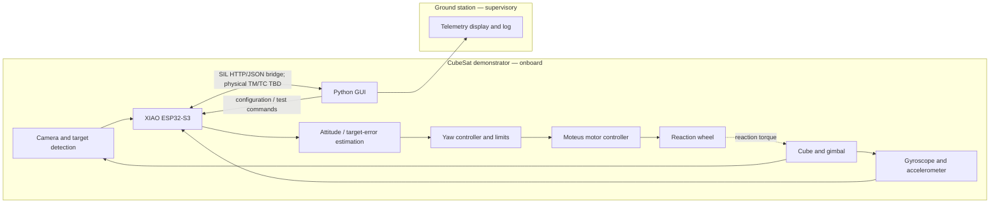

# CubeSat Attitude Control Demonstrator
## Design Description and System Architecture

**Status:** Software-in-the-loop baseline implemented; ESP-IDF build and hardware behavior remain unverified  
**Project:** Aviónica e Espaciónica, University of Aveiro, 2026/27  
**Scope:** One-axis yaw attitude-control demonstrator, progressing from software simulation to a physical gimbal setup

## 1. Purpose

This project develops a small CubeSat-style system that observes a visual target and turns itself to point at it. A camera detects a high-contrast point on a poster. The XIAO ESP32-S3 processes the camera and sensor data, estimates pointing error, and controls a reaction wheel. The wheel changes its angular momentum and applies an opposite torque to the suspended cube.

The autonomous control loop runs onboard. The ground station configures and monitors the system, receives telemetry, and records results; it is not needed to compute or close the pointing loop.

This document describes the current software baseline and separates implemented behavior from proposed hardware behavior. Details marked **TBD** need confirmation from the team, lecturer, or actual kit before hardware implementation.

## 2. System boundary and architecture

The drawing separates responsibilities. It does not imply that the physical radio or all listed sensors are already implemented. The software now has a local HTTP/JSON SIL bridge and an ESP-IDF bridge client for Wokwi; the earlier UDP heartbeat remains a separate Level 0 example. The HTTP bridge is not the selected physical TM/TC link.

### 2.1 Processing allocation

| Function | Location | Notes |
|---|---|---|
| Camera acquisition and image processing | ESP32-S3 | Find the target and calculate image-plane error. Host SIL and default Wokwi process sequence-paired synthetic QVGA frames with the Python and portable C detectors; the physical profile uses the Sense camera. The inputs name OV5640; confirm the actual kit module before pinning hardware settings. |
| IMU and magnetic-field acquisition | ESP32-S3 | Optional MPU-6050 and LIS3MDL drivers report sensor data over a shared I²C bus. Physical magnetometer readings are raw and uncalibrated. |
| Attitude estimate | ESP32-S3 | A yaw-only estimator integrates body-Y gyro rate, initializes relative yaw from a valid accelerometer sample, and can correct with a synthetic/calibrated magnetic reference. Physical firmware disables magnetic correction until calibration and mounting are established. |
| Pointing error | ESP32-S3 | Camera dark-target centroid produces horizontal and vertical image errors. Host SIL uses horizontal error for yaw and vertical error for pitch. |
| Control law and actuator command | ESP32-S3 | Yaw control uses the Y-axis gyro while tracking and continues with a stronger IMU-only rate damping gain when the target is lost. Host SIL adds simulation-only virtual pitch torque and gravity-based roll leveling. Physical pitch/roll actuation remains undefined. |
| Motor commutation/current control | moteus r4.11 | Optional, compile-time disabled ESP-IDF UART adapter serializes bounded torque and commissioning velocity commands and checks returned mode/fault/position/velocity/torque. It uses the moteus r4 AUX2 UART candidate; ESP32-S3 TWAI cannot communicate with CAN-FD directly. C compilation, wiring/logic confirmation and hardware testing remain pending. |
| Telemetry display, configuration, and logging | Ground-station PC | Supervisory role; plots yaw error, displays a frame-matched camera preview/target overlay, shows housekeeping and actuator state, and records CSV. It must not close the autonomous loop. |
| Simulation and offline analysis | PC | Development support only. Final onboard functions remain on the ESP32. |

### 2.2 Initial axis scope

The physical demonstrator and bench plan currently focus on the one specified yaw reaction wheel; hardware for active pitch/roll remains undefined. Per the user's updated simulation request, the host SIL now demonstrates full-direction camera pointing using bounded virtual pitch/roll torques. This does not change physical actuator scope. A point target gives no roll-about-boresight reference, so simulated gravity levels roll. Whether physical axes are constrained or later actuated remains TBD.

## 3. Onboard functional chain

1. **Acquire:** Sample the camera and inertial sensor with timestamps.
2. **Detect:** Threshold grayscale pixels, retain pixels with at least two other dark pixels in their 8-neighbourhood, enforce coherent-area limits, and compute the centroid. This local filter rejects isolated threshold noise but does not distinguish multiple coherent dark objects or calculate a confidence score.
3. **Measure:** Calculate horizontal image displacement from the calibrated optical centre. Convert pixels to angle only after camera intrinsics and mounting alignment are measured. A single image does not by itself provide target range or a 3D position.
4. **Estimate:** Maintain a yaw-only estimate from body-Y gyro integration. The software estimator can blend a magnetic heading reference after tilt compensation; the physical firmware currently reports relative gyro-only yaw because installed sensor orientation and magnetic calibration/interference are unknown. Camera pointing error is handled separately and is not fused into this estimate.
5. **Control:** Convert horizontal camera bearing error and body-Y gyro rate into a bounded reaction-wheel torque request. Host SIL also converts vertical camera error into bounded virtual pitch torque and uses gravity-derived roll leveling; these two torque outputs act only on the simulated plant. A single point target provides no roll-about-camera-axis measurement, so camera-directed roll control needs an oriented marker or another roll reference. The relative yaw-step test instead uses yaw-estimate error and rate. Gains and limits are provisional and require plant/hardware validation.
6. **Protect:** Check sensor/target freshness and validity, bound torque and commissioning speed commands, monitor the moteus status response, and use its finite command watchdog. Normal pointing does not yet enforce a measured wheel-speed limit; the physical safe response still requires hardware verification.
7. **Report:** Send selected housekeeping, sensor, target-error, mode, and actuator data to the ground station. For SIL, the bridge downsamples the exact frame processed by the detector; physical firmware uploads a small grayscale preview about once per second. Image transmission is not required in the control loop.

The camera-to-angle mapping depends on optical alignment and focal length. The current code uses `angle = atan(error_x_px / f_x_px)`, with positive X to the right; telemetry image Y is positive down. These conventions are consistent across the simulator, firmware, and preview overlay, but physical camera orientation, focal length, and controller response sign still require calibration on the kit.

## 4. Ground-station role

The ground station provides a human view of system state and a record of the run. The implemented SIL interface provides:

- Show connection status, operating mode, system state, target validity/error, camera preview with frame-matched target overlay, IMU rate, wheel status, available housekeeping values, and fault flags.
- Timestamp and record telemetry as CSV and plot pointing error against simulation time, preserving gaps when target observations are invalid or camera/IMU samples exceed the 100 ms control freshness limit. The dashboard labels stale sensor samples explicitly.
- Send permitted supervisory commands. The SIL bridge supports `PING`, mode selection, bounded wheel-speed commissioning, and a relative yaw-step request. Both tests require `SAFE`/`STANDBY`; speed testing carries a duration, while yaw-step testing requires a valid onboard estimate. Neither command can set body torque.
- Display acknowledgement or rejection for each telecommand.

During autonomous acquisition, hold, tracking, and disturbance tests, the onboard controller continues without a stream of ground-station commands. The exact command set and operator authority are defined in the TM/TC ICD.

## 5. Operating modes

| Mode | Purpose | Control behavior |
|---|---|---|
| `SAFE` | Startup, fault response, or operator inhibit | Do not begin autonomous pointing. The actuator-safe action must be defined and verified with the motor hardware. |
| `STANDBY` | Sensors and telemetry available | Acquire measurements and report status; no target-pointing command. |
| `RATE_DAMP` | Rate damping | Use body-Y rate feedback to reduce yaw motion. |
| `ACQUIRE` | Find and centre the poster target | Use onboard target error and the yaw controller. |
| `TRACK` | Hold or follow a target setpoint | Continue onboard control; report performance to the ground station. |
| `WHEEL_SPEED_TEST` | Timed actuator commissioning in `SAFE`/`STANDBY` | Use the native wheel velocity command for the requested interval while inhibiting attitude torque control. |
| `WHEEL_SPEED_STOPPING` | End or cancel a speed test | Request zero wheel speed until measured speed is ≤0.5 rev/s or the 10 s stop timeout expires; report the terminal status. |
| `YAW_STEP` | Commanded yaw response milestone | Track a bounded relative yaw setpoint from the onboard estimate; finish after ≤1° error and ≤0.5°/s for 1 s, or enter SAFE on timeout. |
| `FAULT` | Reported fault state, not a selectable operating mode | Controller/actuator fault telemetry inhibits torque; confirm the physical drive safe response before hardware use. |

The host SIL and ESP-IDF bridge firmware implement selectable `SAFE`, `STANDBY`, `RATE_DAMP`, `ACQUIRE`, and `TRACK` modes plus bounded speed-test and relative yaw-step flows. Faults are represented through system/fault telemetry, not a selectable mode. Commands include `PING`, `SET_MODE`, bounded `SET_WHEEL_SPEED`, and `SET_YAW_STEP`. The commissioning state is separate from normal pointing control. The three-axis plant has a yaw reaction-wheel model plus simplified roll/pitch pendula with unmeasured placeholder parameters. Neither model nor software state proves physical actuator safety.

## 6. Development and verification plan

| Level | Increment | Evidence to collect |
|---|---|---|
| 0 | Environment, project structure, and telemetry link to the ground station | Build/run record; packet sequence and heartbeat visible in the ground station. |
| 1 | Motor speed setpoint and hold | Measured speed response, settling time, steady error, and limits. Guide target: 3000 rpm in under 0.5 s and under 2% error; tolerance is marked TBD. |
| 2 | IMU readout and orientation/rate estimate | Bias/noise calibration, estimate error and drift. Guide target: under 2° error and under 2°/min drift. |
| 3 | Closed-loop yaw step response | 45° command and settling within ±1° as proposed by the guide. |
| 4 | Camera target detection on ESP32 | Detection rate, frame rate, latency, false detections, and target-loss behavior. Guide suggests >98% and at least 15 FPS; confirm criteria. |
| 5 | Autonomous visual pointing | Acquire from 30° error in under 6 s; ground station observes but does not close the loop. |
| 6 | Physical disturbance and robustness tests | Hold within ±2° for 60 s; recover from ~20° nudge in under 4 s; follow a moving target; tolerate 2 s camera occlusion. These are proposed guide targets and require a defined measurement method. |

Use increasingly realistic validation: mathematical/model simulation, software-in-the-loop, processor-in-the-loop, then hardware-in-the-loop. Record which parts are simulated or physical in every result. Do not present simulation performance as a physical test result.

## 7. Hardware and software baseline

### Hardware candidates from supplied material

- Seeed Studio XIAO ESP32-S3 Sense with the OV5640 camera evaluation board
  named in the project input; confirm the exact module fitted to the kit.
- MPU-6050 3-axis gyroscope and accelerometer.
- LIS3MDL 3-axis magnetometer. Current firmware support reports a raw field
  vector; it does not estimate heading or fuse it with gyro/accelerometer data.
- Brushless 5208 Kv330 motor, moteus r4.11 controller, reaction wheel, and CAN-FD link.
- Gimbal/suspension, poster target, and onboard power source. Confirm the supplied parts, battery, motor wiring, wheel inertia, and protection before energizing the actuator.

### Software baseline

- ESP-IDF C/C++ firmware for the ESP32-S3.
- Python ground-station application and simulator on the PC.
- Git for source, protocol, and deliverable versioning.
- Current host SIL transport: versioned HTTP/JSON between the local scene, host onboard reference, and Ground Station; the Wokwi firmware uses the Wokwi private gateway to reach the scene. The old UDP/JSON heartbeat is retained separately. Neither is the selected physical Wi-Fi TM/TC link or a CCSDS implementation.

## 8. Principal risks and design constraints

- Camera processing must meet real-time CPU, memory, and latency limits on the target ESP32-S3; verify by measurement before relying on the assumption.
- Image processing is sensitive to lighting, shadows, motion blur, target geometry, and camera alignment. Define confidence thresholds and target-loss behavior.
- Gyroscope bias causes integrated angle drift. Calibrate, timestamp, and validate the fusion method.
- Reaction-wheel speed saturation limits available torque and momentum storage. Include speed limits, desaturation strategy if applicable, and recovery behavior in the model.
- Gimbal friction, imbalance, wiring torque, and bearing play can dominate the small-scale bench dynamics. Measure them rather than assuming an ideal free body.
- The motor and battery can deliver hazardous current. Establish current limits, fuse/kill method, restrained first power-up, and a no-person-in-rotation-zone test procedure with the hardware owner.
- The physical actuator design currently supports only yaw. Host SIL can demonstrate three-axis pointing with virtual pitch/roll torques; keep this simulation result distinct from physical three-axis attitude-control evidence in reports.
- Ground-station communication can be delayed or lost. Autonomous control must use onboard measurements and continue or enter a defined safe mode without requiring the PC.

## 9. Open decisions

1. Confirm actual camera module/resolution and ESP32-S3 Sense board revision.
2. Confirm whether the first test fixture locks roll/pitch or uses the full gimbal.
3. Decide whether the magnetometer is needed for the one-axis experiment.
4. Agree target-image coordinate, optical-centre calibration, error sign, and yaw sign conventions.
5. Confirm the motor/wheel configuration, UART or external CAN-FD interface, and safe limits from datasheets and lab hardware.
6. Select the physical telemetry link and packet format. Keep both the SIL HTTP/JSON bridge and legacy UDP/JSON example distinct from any claim of CCSDS compliance.
7. Confirm each numerical success criterion and exactly how it is measured.

## 10. Source basis

- `../Source/1-project_guide.pdf` — project narrative, architecture, proposed tests, staged plan, candidate hardware, and report deliverables.
- `../Source/0-Guiao.pdf` — course assessment and AI-use rules.
- `../inputs/Dicas.txt` and `../inputs/sumury.txt` — working notes and roadmap, updated with the user's confirmed onboard-processing decision.
- `Python_sim/` — existing Level 0 code snapshot; details and limitations are recorded in `../Context/CODE_REVIEW.md`.
- OpenCV, [3D vision and pinhole projection model](https://docs.opencv.org/5.0/main_modules/d_projection.html) — camera intrinsic matrix and pixel projection used as the basis for the candidate pixel-to-bearing relation above.
